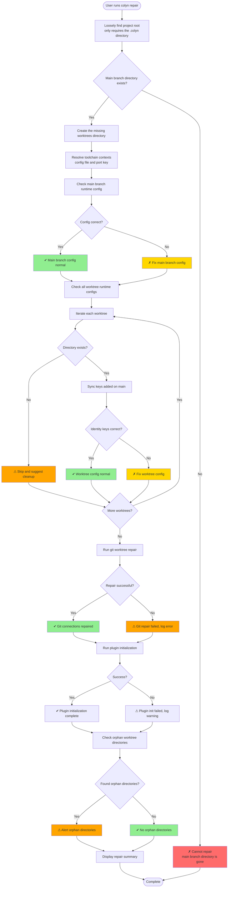
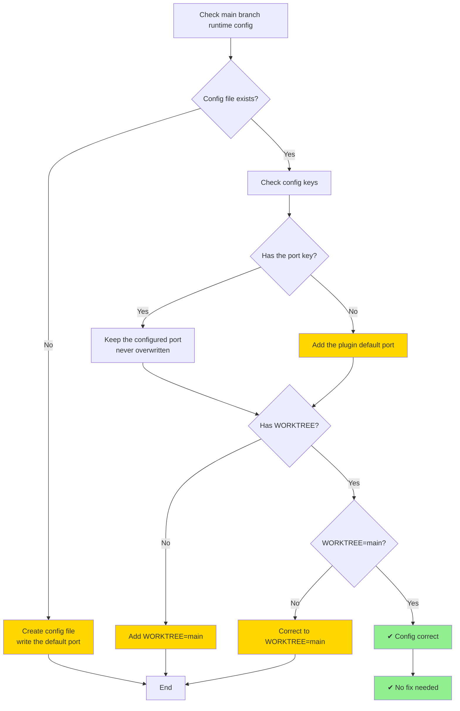
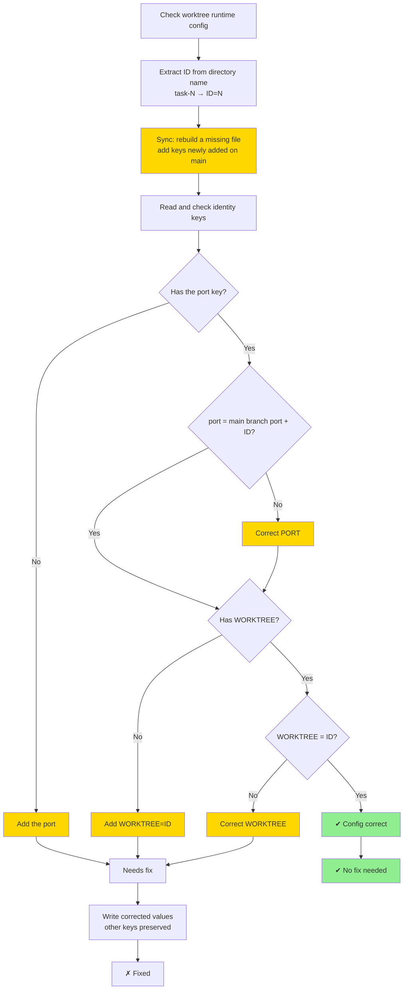
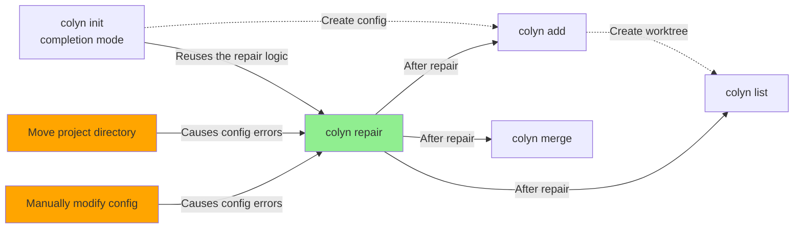

# Repair Command Design Document (User Interaction Perspective)

**Created**: 2026-01-17
**Last Updated**: 2026-06-03 (updated: Todo Backend setup repair)
**Command**: `colyn repair`
**Status**: ✅ Implemented

---

## 1. Command Overview

### 1.1 User Goal

Users want to quickly check and fix project configuration errors after moving the entire project directory, ensuring all worktrees work properly.

### 1.2 Command Usage

```bash
# Basic usage (auto-fix all issues)
colyn repair
```

### 1.3 Execution Result

After execution, the system will:
1. Create the missing project directory structure (`worktrees/`)
2. Check and fix the main branch **runtime config**
3. Rename worktree directories that still use an old prefix to the current `worktreePrefix` (see 6.5)
4. Sync config keys newly added on the main branch to each worktree, then check and fix each worktree's **runtime config**
5. Run `git worktree repair` to fix git connections
5. Run plugin initialization (non-fatal — only shows a warning on failure)
6. **Run setup for the current active Todo Backend** (non-fatal):
   - Local backend: no additional action
   - GitHub backend: verify that `gh` is installed and authenticated; if not installed, suggest installation steps; if not authenticated, suggest `gh auth login`
7. Detect and report orphan worktree directories (directories that exist but git doesn't recognize)

> **The runtime config file is decided by the toolchain plugin**: npm / pip projects use
> `.env.local` (port key `PORT`), maven / gradle projects use
> `src/main/resources/application-local.properties` (port key `server.port`).
> In a Mono Repo each sub-project is checked and fixed independently.
> With no toolchain, it falls back to `.env.local`.

---

## 2. User Scenarios

### 2.1 Scenario 1: Fix After Moving Project Directory

**User Situation**: Moved entire project from `/Users/user/project` to `/Users/user/Desktop/project`

**Problem Symptoms**:
- Git worktree cannot recognize individual worktrees
- Git commands fail with worktree not found errors

**Operation Flow**:

```bash
# After moving directory
$ cd /Users/user/Desktop/project

# Run repair command
$ colyn repair

✔ Check main branch .env.local
✔ Check worktree task-1 .env.local
✔ Check worktree task-2 .env.local
✔ Repair git worktree connections
✔ Plugin initialization complete
✔ Check orphan worktree directories

✓ Repair complete!

Repair summary:
  ✓ Git worktree connections repaired
  ✓ Checked 3 .env.local files, no issues
  ✓ No orphan worktree directories found
```

**Result**: All worktrees restored to normal operation

---

### 2.2 Scenario 2: .env.local File Accidentally Modified

**User Situation**: Manually modified some worktree `.env.local` files, causing configuration inconsistency

**Problem Symptoms**:
- task-1's PORT=10005, but should be 10001
- task-2's WORKTREE=3, but directory name is task-2

**Operation Flow**:

```bash
$ colyn repair

✔ Check main branch .env.local
✗ Fix worktree task-1 .env.local
  - PORT: 10005 → 10001
✗ Fix worktree task-2 .env.local
  - WORKTREE: 3 → 2
✔ Repair git worktree connections
✔ Check orphan worktree directories

✓ Repair complete!

Repair summary:
  ✓ Fixed 2 .env.local files
  ✓ Git worktree connections normal
  ✓ No orphan worktree directories found
```

**Result**: All configurations restored to correct values

---

### 2.3 Scenario 3: Orphan Worktree Directories Exist

**User Situation**: Manually deleted git worktree but directory still exists

**Problem Symptoms**:
- `worktrees/task-3` directory exists
- But `git worktree list` doesn't show this worktree

**Operation Flow**:

```bash
$ colyn repair

✔ Check main branch .env.local
✔ Check worktree task-1 .env.local
✔ Check worktree task-2 .env.local
✔ Repair git worktree connections
⚠ Found orphan worktree directories

✓ Repair complete!

Repair summary:
  ✓ Checked 3 .env.local files, no issues
  ✓ Git worktree connections normal
  ⚠ Found 1 orphan worktree directory:
    - worktrees/task-3 (directory exists but git doesn't recognize)

Suggested action:
  Run colyn remove command to clean up, or manually delete directory
```

**Result**: Alert user about orphan directories that need manual cleanup

---

## 3. User Interaction Flow

### 3.1 Overall Flow Diagram



### 3.2 Check and Fix Logic

#### Main Branch Runtime Config Check



#### Worktree Runtime Config Check



---

## 4. Input and Output

### 4.1 User Input

| Input | Description | Required |
|-------|-------------|----------|
| None | repair command needs no parameters, auto-checks and fixes | - |

### 4.2 System Output

**Check progress** (using spinner):
```
✔ Check main branch .env.local
✔ Check worktree task-1 .env.local
✗ Fix worktree task-2 .env.local
  - PORT: 10005 → 10002
  - WORKTREE: 3 → 2
✔ Repair git worktree connections
✔ Plugin initialization complete
✔ Check orphan worktree directories
```

**Repair summary**:
```
✓ Repair complete!

Repair summary:
  ✓ Fixed 1 .env.local file
  ✓ Git worktree connections repaired
  ✓ No orphan worktree directories found

Details:
  Main branch:
    ✓ .env.local config correct

  Worktree task-1:
    ✓ .env.local config correct

  Worktree task-2:
    ✗ PORT error: 10005 → 10002
    ✗ WORKTREE error: 3 → 2
```

---

## 5. Error Handling

### 5.1 Common Errors and Handling

| Error Scenario | System Behavior | User Sees |
|----------------|-----------------|-----------|
| **Project not initialized** | Error and exit | ✗ Project not initialized<br/>Hint: Please run colyn init first |
| **Not a git repository** | Error and exit | ✗ Main branch directory is not a git repository<br/>Hint: Please run in a git project |
| **git worktree repair failed** | Log error, continue other checks | ⚠ Git worktree repair failed<br/>Error: [git error]<br/>Suggestion: Manually run git worktree repair |
| **Plugin initialization failed** | Log warning, continue other checks | ⚠ Plugin initialization failed (non-fatal)<br/>Error: [error message] |
| **Cannot read main branch .env.local** | Mark this check item as failed, do not create file | ✗ Main branch .env.local check failed<br/>Error: [read error] |
| **Cannot write .env.local** | Log error, continue other checks | ⚠ Cannot fix worktree task-1 .env.local<br/>Error: Permission denied |

### 5.2 Error Handling Principles

- **Best effort**: Single error doesn't stop, continue checking other items
- **Detailed logging**: All errors logged and displayed in summary
- **Provide suggestions**: Tell user how to manually resolve unfixable issues

---

## 6. Check Rules Explained

### 6.0 Locating the Runtime Config File

Both the config file path and the port key come from the **toolchain plugin** —
repair hardcodes no assumptions:

| Toolchain | Config file | Port key | Default port |
|-----------|-------------|----------|--------------|
| npm / pip | `.env.local` | `PORT` | 3000 / 8000 |
| maven / gradle | `src/main/resources/application-local.properties` | `server.port` | 8080 |
| No toolchain (fallback) | `.env.local` | `PORT` | 10000 |

In a Mono Repo, every sub-project with a configured toolchain is its own check item and is
listed separately in the summary as `Main branch runtime config [backend]`.
Sub-directories that don't exist in a worktree are skipped.

### 6.1 Main Branch Runtime Config Check Rules

**Identity keys**:
- Port key: keep the existing value (never modified); the plugin's default port is written only when it is missing
- `WORKTREE`: Must be `"main"`

**Fix strategy**:
- If the config file is missing: create it with the default port and `WORKTREE=main`
- If the port is missing: add the plugin's default port
- If WORKTREE is not "main": correct to "main"
- All other config keys are preserved untouched

### 6.2 Worktree Runtime Config Check Rules

**Directory name parsing**:
- Extract ID from directory name: `task-1` → ID = 1

**Identity keys**:
- Port key: Must be `main branch port of the same sub-project + ID`
- `WORKTREE`: Must be `ID` (numeric string)

**Fix strategy**:
1. First run the **runtime config sync** (`main-to-worktree`):
   - Rebuild the config file from the main branch when it is missing, recomputing the identity keys
   - Add keys that exist on the main branch but not yet in the worktree (same key with a different value is recorded as a conflict and never overwritten)
2. Then correct the identity keys: a wrong port becomes `main branch port + ID`, a wrong WORKTREE becomes `ID`
3. When the worktree directory is gone (git still records it), skip it and suggest `colyn remove` or `git worktree prune`

**Example** (maven sub-project, main branch `server.port=8080`):
```
worktrees/task-1/src/main/resources/application-local.properties:
  server.port=8081  ✓ Correct (8080 + 1)
  WORKTREE=1        ✓ Correct

worktrees/task-2/src/main/resources/application-local.properties:
  server.port=9999  ✗ Wrong → Correct to 8082 (8080 + 2)
  WORKTREE=3        ✗ Wrong → Correct to 2
```

### 6.3 Git Worktree Connection Repair

**Execute command**:
```bash
cd <main-branch-directory>
git worktree repair
```

**Git automatically repairs**:
- Bidirectional connection between main branch and worktree
- Path in worktree's `.git` file
- Management files in `.git/worktrees/`

### 6.4 Orphan Worktree Directory Detection and Repair

**Detection logic**:
1. Use `git worktree list --porcelain` to get all worktrees (including those with invalid paths)
2. Scan all `{prefix}-N` directories under `worktrees/` (`prefix` is the current `worktreePrefix` setting)
3. Smart matching: Match git records and actual directories by branch name

**Types of orphan directories**:

1. **Invalid path type** (repairable):
   - Cause: Project directory was moved or renamed
   - Symptom: Path in git worktree list doesn't exist, but branch name matches
   - Handling: Use `git worktree repair <new-path>` to repair path

2. **True orphan type** (report only):
   - Cause: Manually deleted worktree, or git data corrupted
   - Symptom: Directory exists but git completely doesn't recognize
   - Handling: Report only, suggest user cleanup manually

**Repair strategy**:
```bash
# For worktree with invalid path
git worktree repair /new/path/to/worktrees/task-1

# Updates the worktree path recorded in git
```

**Matching logic**:
- Read branch name from the actual directory's `.git` file or git repository
- Match with branch name in git worktree list
- Successful match means invalid path type, can be repaired

### 6.5 Worktree Directory Name Prefix Migration

**Trigger**: The `worktreePrefix` setting differs from the prefix of existing directories under `worktrees/` (e.g. the setting is now `edt` but directories are still `task-1`).

**When it runs**: Before worktree discovery. Discovery only recognizes the current prefix, so renaming must happen first.

**Detection rules**:
1. Directory name matches `{oldPrefix}-{N}` and `oldPrefix` differs from the current prefix
2. Directory is registered in `git worktree list --porcelain` (only git-known directories are touched, so unrelated directories the user dropped in are never renamed)

**Rename method**:
```bash
git worktree move worktrees/task-1 worktrees/edt-1
```
Git updates the `.git/worktrees/` metadata and the `.git` pointer file inside the worktree together. The `WORKTREE` key in the runtime config stores the numeric ID and needs no change.

**Status key migration**: The `task-1` entry in `.colyn/status.json` becomes `edt-1`; the status value is kept.

**Failure handling**: If the target directory already exists or `git worktree move` fails, the entry is recorded and reported in the summary; other directories are still processed.

**Implementation**: `src/core/worktree-prefix-migration.ts`

---

## 7. Project State After Success

### 7.1 Before and After Comparison

**Before repair (after moving directory)**:
```
# Git worktree status
$ git worktree list
fatal: 'worktree' does not point back to '/old/path/project'

# task-1 .env.local
PORT=10005      # Wrong
WORKTREE=3      # Wrong
```

**After repair**:
```
# Git worktree status
$ git worktree list
/new/path/project/my-project         (main)
/new/path/project/worktrees/task-1   (feature/login)
/new/path/project/worktrees/task-2   (feature/dashboard)

# task-1 .env.local
PORT=10001      # Correct
WORKTREE=1      # Correct
```

---

## 8. Relationship with Other Commands



**Description**:
- `repair` is a maintenance command for fixing configuration errors
- Usually run after moving directory or manually modifying configuration
- After repair, other commands can work normally
- When `colyn init` runs in an already initialized directory (completion mode) it calls
  `repairProject()`, skipping the toolchain and todo backend steps it has already done, so
  both commands share one repair implementation and cannot drift apart

---

## 9. Special Case Handling

### 9.1 Cannot Determine Base Port

**Scenario**: Main branch `.env.local` file doesn't exist or PORT is missing

**Handling**:
- Try to infer from `git worktree list` (if there are worktrees)
- Otherwise use default value 10000

### 9.2 Non-standard Worktree Directory Names

**Scenario**: Directories under `worktrees/` that don't follow the current `{prefix}-N` format

**Handling**:
- Directories shaped like `{otherPrefix}-N` and registered in git: renamed to the current prefix per 6.5
- Everything else: skipped, warned in summary

### 9.3 Git worktree repair Unavailable

**Scenario**: Git version too old, doesn't support `repair` subcommand

**Handling**:
- Detect git version
- If not supported, skip git repair, prompt user to upgrade git

---

## 10. FAQ

### Q1: When do I need to run the repair command?

A: Run in these situations:
- Moved the entire project directory
- Manually modified `.env.local` files causing configuration errors
- Git worktree connection issues
- Suspect configuration inconsistency

### Q2: What files does repair modify?

A: Only modifies PORT and WORKTREE variables in `.env.local` files, doesn't modify other environment variables or project files.

### Q3: Does repair delete files?

A: No. Even if orphan worktree directories are found, it only reports, doesn't auto-delete.

### Q4: What if repair fails?

A: repair uses "best effort" strategy, single error doesn't cause entire command to fail. Check error info in summary, manually handle based on suggestions.

### Q5: Where do I run the repair command?

A: Can run from anywhere in the project, system automatically finds project root.

### Q6: Does repair affect git history?

A: No. repair only fixes management files and environment variable configuration, doesn't involve git commit history.

---

## 11. Implementation Notes

### 11.1 Technical Requirements

- Run from anywhere in project (use `findProjectRootLoose`, which tolerates a broken directory structure)
- All runtime config reads and writes go through the toolchain plugin — no hardcoded file name or port key
- Use ora spinner to show progress for each check item
- Errors don't interrupt flow, log and continue
- Display all repairs and errors in summary at end

### 11.2 Key Functions

| Function Name | Purpose | Input | Output |
|---------------|---------|-------|--------|
| `repairProject` | Main function | RepairOptions | void |
| `repairProjectStructure` | Create the missing directory structure | paths | RepairResult |
| `checkMainRuntimeConfig` | Check main branch runtime config | target | RepairResult |
| `checkWorktreeRuntimeConfig` | Check worktree runtime config | target, mainTarget, wtId | RepairResult |
| `repairGitWorktree` | Repair git worktree connections | mainDir | RepairResult |
| `detectAndRepairOrphans` | Detect and repair orphan worktree directories | mainDir, worktreesDir | OrphanDetectionResult |
| `displayRepairSummary` | Display repair summary | results[] | void |

### 11.3 Data Structures

```typescript
interface RepairResult {
  /** Check item name */
  item: string;
  /** Whether successful */
  success: boolean;
  /** Whether fixed */
  fixed: boolean;
  /** Fix details */
  details?: string[];
  /** Error message */
  error?: string;
  /** Why the check was skipped (e.g. the worktree directory is gone) */
  skippedNote?: string;
}

/** repair options: init's completion mode reuses repairProject and skips what it already did */
interface RepairOptions {
  skipToolchainSetup?: boolean;
  skipTodoSetup?: boolean;
  nonInteractive?: boolean;
  contexts?: ToolchainContext[];
}

interface OrphanDetectionResult {
  /** Repaired orphans (invalid path type) */
  repairedOrphans: string[];
  /** True orphans (git completely doesn't recognize) */
  trueOrphans: string[];
  /** Failed repairs */
  repairFailed: Array<{ dir: string; error: string }>;
}
```

---

## 12. Summary

`colyn repair` command design priorities:

1. **Automation**: No parameters needed, auto-checks and fixes all issues
2. **Fault tolerance**: Single error doesn't interrupt flow, fix as many issues as possible
3. **Safety**: Only fix clear configuration errors, don't delete files
4. **Transparency**: Display each check item and repair result in detail
5. **Practicality**: Solve common issues after moving directory

**Best practices**:
- Run `colyn repair` immediately after moving project directory
- Run periodically to check configuration consistency
- Run when git worktree issues occur
